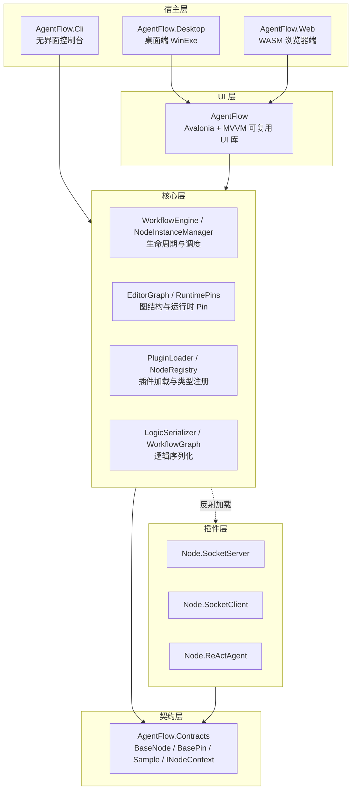

# AgentFlow 软件平台架构说明

## 1. 平台定位

AgentFlow 是一个可视化节点工作流平台：开发者在画布上编排节点、连接 Pin、配置参数，
工作流以 JSON 持久化，并可在桌面端、无界面控制台或浏览器中运行同一套核心逻辑。

平台围绕三条主线设计：

- **契约与实现分离**：节点开发者只依赖契约层，不感知 UI 与引擎。
- **核心逻辑零 UI 依赖**：Core 可独立托管于控制台、服务端或浏览器后端。
- **插件化节点**：一个 DLL 实现一个节点，运行时反射加载，可热插拔。

## 2. 分层架构



## 3. 工程职责

| 工程 | 职责 | 依赖 |
|---|---|---|
| `AgentFlow.Contracts` | 节点契约：`BaseNode`、`BasePin`、`Sample` 类型体系、`DataType`、`INodeContext`、参数与 ID 池 | 仅日志抽象，无 UI |
| `AgentFlow.Core` | 插件加载、节点实例容器、图结构、运行时 Pin、工作流引擎、逻辑序列化、日志适配 | Contracts |
| `AgentFlow` | Avalonia UI 库：自绘画布、节点库、对话框、MVVM（Views/ViewModels/Models）、GUI 序列化 | Core |
| `AgentFlow.Desktop` | 桌面宿主入口，插件 DLL 复制到 `plugins/` | AgentFlow UI |
| `AgentFlow.Cli` | 无界面宿主，加载 workflow.json 运行同一套 Core 引擎 | Core、Contracts |
| `AgentFlow.Web` | `net10.0-browser` WASM 宿主，复用同一 UI 库，经 HTTP 后端存取工作流 | AgentFlow UI |
| `plugins/*` | 一个 DLL 一个节点（`IsPlugin=true`），只引用契约层 | Contracts |
| `SeriLog.Bin` | 外部 `Rolling.Logging` 组件（基于 Serilog，控制台 + 滚动文件） | 独立组件 |

## 4. 关键设计

### 4.1 契约层：节点开发的唯一入口

- 节点继承 `BaseNode`，在 `AddPins()` 中通过 `AddInputPin` / `AddOutputPin` 声明端口。
- Pin 之间传递的数据统一封装为 `Sample`（`Int32Sample`、`StringSample`、`BinSample` 等），
  按 `DataType` 做类型校验，仅用于内存传递、不参与持久化。
- 引擎通过 `INodeContext` 向节点提供输入读取、输出写入、日志与宿主服务解析。
- 外部合作者拿到 `AgentFlow.Contracts.dll` 即可开发节点，无需 UI 或 Core 源码。

### 4.2 数据流

输出 Pin 调用 `SendSample` → 经 `ConnectedPin` 推送到下游输入 Pin 的 `ReceiveSample`
→ 触发 `BasePin.OnReceive` → 转交所属节点的 `BaseNode.ReceiveSample`。连接关系保存在
Pin 的 `ConnectedPin` 引用中，节点之间不直接持有彼此。

### 4.3 插件与实例管理

- `PluginLoader` 扫描 `plugins/` 目录，经反射发现节点类型并登记到 `NodeRegistry`。
- 节点实例由 Core 统一容器管理，实例 ID 位于 1000–10000，分配最小可用 ID，删除后回收。
- 插件工程仅引用契约层，MSBuild 目标自动把产物 DLL 复制到各宿主的 `plugins/` 目录。

### 4.4 分层序列化

- **Core 层** `LogicSerializer` / `LogicDeserializer`：只处理节点逻辑参数，忽略坐标等 GUI 信息。
- **UI 层** `GraphSerializer` / `GraphDeserializer`：合并逻辑 JSON 与坐标、连线等界面信息，
  组装完整工作流文档。Core 因此不依赖任何 UI 概念即可独立运行。

### 4.5 持久化抽象

UI 通过 `IWorkflowStore` 存取工作流：桌面端使用本地文件实现，Web 端替换为
`HttpWorkflowStore` 走后端 API，同一套 ViewModel 无需改动。

### 4.6 日志

全平台统一使用 `Microsoft.Extensions.Logging.ILogger` 抽象，Core 提供
`RollingLoggerProvider` 把日志转发到 `Rolling.Logging`（Serilog），输出到控制台与滚动文件；
桌面端额外保留 UI 日志面板的 Provider。

## 5. 运行形态

| 形态 | 入口 | 说明 |
|---|---|---|
| 桌面应用 | `AgentFlow.Desktop` | 可视化编排 + 本地运行，跨 Windows/Linux |
| 无界面运行 | `AgentFlow.Cli <workflow.json> [pluginDir]` | 服务器/自动化场景，复用同一 Core |
| 浏览器 | `AgentFlow.Web` | UI 编译为 WASM，文件与插件加载下沉到后端 |

## 6. 构建

```powershell
# 解决方案（桌面/CLI/契约/Core 为 net8.0，Web 为 net10.0-browser）
dotnet build AgentFlow.sln

# 无界面运行示例
dotnet run --project AgentFlow.Cli -- sample.workflow.json
```

插件工程构建后由 MSBuild 目标自动复制到 Desktop / Cli / UI 的 `plugins/` 输出目录，
无需手工拷贝。
