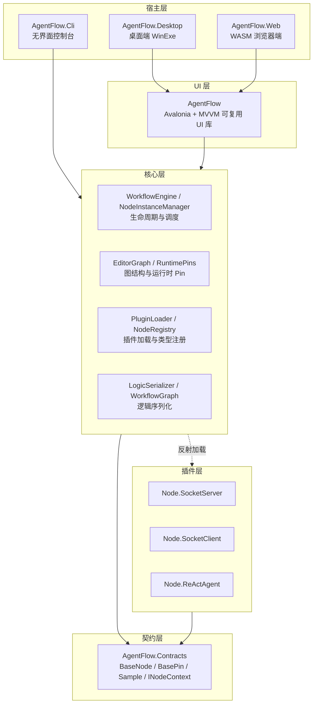

# AgentFlow 软件平台架构说明

## 1. 平台定位

AgentFlow 是一个可视化节点工作流平台：开发者在画布上编排节点、连接 Pin、配置参数，
工作流以 JSON 持久化，并可在桌面端、无界面控制台或浏览器中运行同一套核心逻辑。

平台围绕三条主线设计：

- **契约与实现分离**：节点开发者只依赖契约层，不感知 UI 与引擎。
- **核心逻辑零 UI 依赖**：Core 可独立托管于控制台、服务端或浏览器后端。
- **插件化节点**：一个 DLL 实现一个节点，运行时反射加载，可热插拔。

## 2. 分层架构



## 3. 工程职责

| 工程 | 职责 | 依赖 |
|---|---|---|
| `AgentFlow.Contracts` | 节点契约：`BaseNode`、`BasePin`、`Sample` 类型体系、`DataType`、`INodeContext`、参数与 ID 池 | 仅日志抽象，无 UI |
| `AgentFlow.Core` | 插件加载、节点实例容器、图结构、运行时 Pin、工作流引擎、逻辑序列化、日志适配 | Contracts |
| `AgentFlow` | Avalonia UI 库：自绘画布、节点库、对话框、MVVM（Views/ViewModels/Models）、GUI 序列化 | Core |
| `AgentFlow.Desktop` | 桌面宿主入口，插件 DLL 复制到 `Plugins/` | AgentFlow UI |
| `AgentFlow.Cli` | 无界面宿主，加载 workflow.json 运行同一套 Core 引擎 | Core、Contracts |
| `AgentFlow.Web` | `net10.0-browser` WASM 宿主，复用同一 UI 库，经 HTTP 后端存取工作流 | AgentFlow UI |
| `Plugins/*` | 一个 DLL 一个节点（`IsPlugin=true`），只引用契约层 | Contracts |
| `SeriLog.Bin` | 外部 `Rolling.Logging` 组件（基于 Serilog，控制台 + 滚动文件） | 独立组件 |

## 4. 关键设计

### 4.1 契约层：节点开发的唯一入口

- 节点继承 `BaseNode`，在 `AddPins()` 中通过 `AddInputPin` / `AddOutputPin` 声明端口。
- Pin 之间传递的数据统一封装为 `Sample`（`Int32Sample`、`StringSample`、`BinSample` 等），
  按 `DataType` 做类型校验，仅用于内存传递、不参与持久化。
- 引擎通过 `INodeContext` 向节点提供输入读取、输出写入、日志与宿主服务解析。
- 外部合作者拿到 `AgentFlow.Contracts.dll` 即可开发节点，无需 UI 或 Core 源码。

### 4.2 数据流

输出 Pin 调用 `SendSample` → 经 `ConnectedPin` 推送到下游输入 Pin 的 `ReceiveSample`
→ 触发 `BasePin.OnReceive` → 转交所属节点的 `BaseNode.ReceiveSample`。连接关系保存在
Pin 的 `ConnectedPin` 引用中，节点之间不直接持有彼此。

### 4.3 插件与实例管理

- `PluginLoader` 扫描 `Plugins/` 目录，经反射发现节点类型并登记到 `NodeRegistry`。
- `PluginLoader.LoadFromDirectory` 支持传入当前 workflow 的节点类型集合：传入集合时先并行读取 DLL 元数据，只加载匹配的插件；不传集合时保持原有全量扫描，供编辑器节点库使用。
- `ExternalNodeCatalog.RegisterFromDirectory` 并行预扫描外部节点 `plugin.json`，并按请求类型只注册匹配的外部节点；只有注册成功时才创建外部 Worker Runtime。
- 节点实例由 Core 统一容器管理，实例 ID 位于 1000–10000，分配最小可用 ID，删除后回收。
- 插件工程仅引用契约层，MSBuild 目标自动把产物 DLL 复制到各宿主的 `Plugins/` 目录。

### 4.4 多实例运行管理

Core 提供 `WorkflowRunManager` 和 `WorkflowRunSession`，用于在同一进程内运行多个独立工作流实例。每个 Session 拥有独立的 `NodeRegistryScope`、外部 Worker Runtime、`TopicBus` 广播实例、NodeServiceRegistry、WorkflowGraph、Node 实例、CancellationToken、日志工厂以及最终结果；实例之间不会共享运行中的节点对象、外部 Worker 进程或广播订阅。Batch Run 的 `AutoStop` 只请求当前 RunId 停止，不会隐式取消整批。

默认失败策略是 `ContinueOthers`：一个实例失败只记录自身失败，不影响其他实例。CLI 通过该共享运行管理器启动同一工作流的多实例或不同工作流的混合批次，并在 Ctrl+C 时请求所有实例执行 Stop/Shutdown 后统一汇总退出状态。

Desktop 明确区分两种运行模式：工具栏 `Editor Run` 用于画布内交互调试；底部 `Batch Run` 面板用于正式多实例运行，并复用同一个 Core 管理器。用户可以组合多个 `.rw` 工作流文件，每个来源配置 1–50 个实例。`MaxConcurrency` 是整个 Batch 面板共享的全局限制，不是每行独立限制；`RunMode=Auto` 会在有限工作流自然完成后返回成功，只有包含 `RequiresPersistentHost=true` 节点（例如 TCP Client/TCP Server）的工作流才保持运行直到 Stop。Editor Run 与 Batch Start 通过同步 `RunStartGate` 互斥，避免定时刷新状态造成的启动竞态。

每个实例日志使用 `RunId` 标签写入 UI 日志面板；Log 面板支持按 RunId 或前缀筛选，并为每个 RunId 单独保留最近 50 条 ERROR 日志。关闭窗口时 Desktop 会同时等待编辑器运行和所有批量实例完成 Stop/Shutdown 后再退出。Stop/Shutdown 的节点级失败会进入 `CleanupError`，成功运行如果清理失败会降级为 Failed，避免资源泄漏被静默忽略。

自动化集成测试覆盖同工作流/不同工作流多实例、失败隔离、StopAll、广播隔离、AutoStop 仅停止当前实例、单批与跨管理器全局并发限制、10 实例压力运行、排队实例 Stop、Auto 有限工作流、清理失败上报及 StopAll 旧结果清理；同时实际启动 Python、C、C++ 外部节点各自 3 个实例，验证每组实例拥有独立的 Worker 进程、各自产生双输入/双输出结果且互不共享。

CLI 支持多工作流、多实例、全局 `--max-concurrency`、`--failure-policy ContinueOthers|CancelBatch`、`--run-mode RunOnce|Auto|Persistent`，并可通过 `--output-json` 输出包含 RunId、状态、时间、ExitCode、Error、CleanupError 和 EffectiveError 的稳定 JSON 结果。退出码约定为：0 全部成功；1 至少一个失败或取消；2 参数错误；130 Ctrl+C。
### 4.5 分层序列化

- **Core 层** `LogicSerializer` / `LogicDeserializer`：只处理节点逻辑参数，忽略坐标等 GUI 信息。
- **UI 层** `GraphSerializer` / `GraphDeserializer`：合并逻辑 JSON 与坐标、连线等界面信息，
  组装完整工作流文档。Core 因此不依赖任何 UI 概念即可独立运行。

### 4.6 持久化抽象

UI 通过 `IWorkflowStore` 存取工作流：桌面端使用本地文件实现，Web 端替换为
`HttpWorkflowStore` 走后端 API，同一套 ViewModel 无需改动。

保存前会分配缺失的 PinId、检查 PinId 唯一性，并执行完整工作流校验（节点 Id/类型、Pin 类型与连接、必填输入、DependsOn 和环路）；校验失败时磁盘文件不会被覆盖。用户设置采用“临时文件写入 + 原子替换”方式保存，避免进程中断留下半个 JSON 文件。

### 4.7 日志

全平台统一使用 `Microsoft.Extensions.Logging.ILogger` 抽象，Core 提供
`RollingLoggerProvider` 把日志转发到 `Rolling.Logging`（Serilog），输出到控制台与滚动文件；
桌面端额外保留 UI 日志面板的 Provider。`Hosting.Logging.AppLog.CreateLoggerFactory(LogLevel)` 允许宿主设置最低日志级别；RTS 使用 `Information`，同时通过 Serilog `LoggingLevelSwitch` 限制 sink 输出级别。

## 5. 运行形态

| 形态 | 入口 | 说明 |
|---|---|---|
| 桌面应用 | `AgentFlow.Desktop` | 可视化编排 + 本地运行，跨 Windows/Linux |
| 无界面运行 | `AgentFlow.Cli <workflow.json> [pluginDir]` | 服务器/自动化场景，复用同一 Core |
| 浏览器 | `AgentFlow.Web` | UI 编译为 WASM，文件与插件加载下沉到后端 |

## 6. 构建

```powershell
# 解决方案（桌面/CLI/契约/Core 为 net8.0，Web 为 net10.0-browser）
dotnet build AgentFlow.sln

# 无界面运行示例
dotnet run --project AgentFlow.Cli -- sample.workflow.json

# Debug + Release + 集成测试 + SDK 打包（可选项见脚本头部）
pwsh -File Scripts/Build-Release.ps1

# 只做本地包，不编译外部语言节点
pwsh -File Scripts/Build-Release.ps1 -SkipExternal -SkipTests

# 无界面多实例 + JSON 结果
dotnet run --project AgentFlow.Cli -- --workflow sample.workflow.rw --instances 5 `
  --max-concurrency 3 --failure-policy ContinueOthers --run-mode Auto `
  --output-json .\artifacts\cli-result.json
```

插件工程构建后由 MSBuild 目标自动复制到 Desktop / Cli / UI 的 `Plugins/` 输出目录，
无需手工拷贝。

外部多语言节点源码位于 `Plugins/External` 下的语言分类目录，例如
`Plugins/External/Python/Node.PythonUpper`。宿主 Build/Publish 时会按源码指纹增量构建，
并按当前标准 RID 把产物复制到输出目录的 `Plugins/External/<RID>`；源码未变化时只复制已有产物，不重复编译。
## 7. Windows 原生 VC++ 节点

Windows 专用节点采用“稳定 C ABI + 托管代理 + 有界队列”的架构，不修改 Core 层的插件发现机制：

```text
VC++ node DLL
  -> AfNode C ABI
  -> AgentFlow.Windows.NativeHost
  -> bounded Channel (per node, capacity 1024)
  -> NativeNodeBackgroundPump (serial)
  -> BasePin.SendSample / ILogger
```

- 源码：`Plugins/Windows/Src`，其中 `AgentFlow.NativeNodeApi/agentflow_node_api.h` 定义 ABI。
- 原生节点：每个节点目录包含 VC++ 工程、实现文件和 `manifest.json`。
- 托管桥：`Plugins/Windows/AgentFlow.Windows.NativeHost`，由 `manifest.json` 生成 `BaseNode` 代理。
- 生成器：`Tools/NativeNodeCodeGen`。
- 部署：`Plugins/Windows/win-x64/<ModuleId>`，Desktop/CLI 构建时自动同步到输出目录。
- 节点类别：`Category=C` 表示跨平台通用节点，`W` 表示 Windows 专用节点，`E` 表示外部 Worker 节点；Components 图标右下角只显示 `W` 或 `E`，`C` 不显示角标。
- 回调约束：原生回调只可复制数据并入队，不得直接调用托管 `BasePin`；Sample 缓冲区仅在 ABI 调用期间有效。
- 队列满：`sendSample` 返回 `AF_ERR_QUEUE_FULL`，调用方必须处理该状态，不能无限阻塞原生线程。
- 运行时链接：Debug 使用 `/MTd`，Release 使用 `/MT`，避免依赖 `MSVCP*.dll` 或 `VCRUNTIME*.dll`。

示例 `Node.NativeUpperCase.Windows` 已实现 `input_string -> output_string`，将 ASCII 小写字母转换为大写。